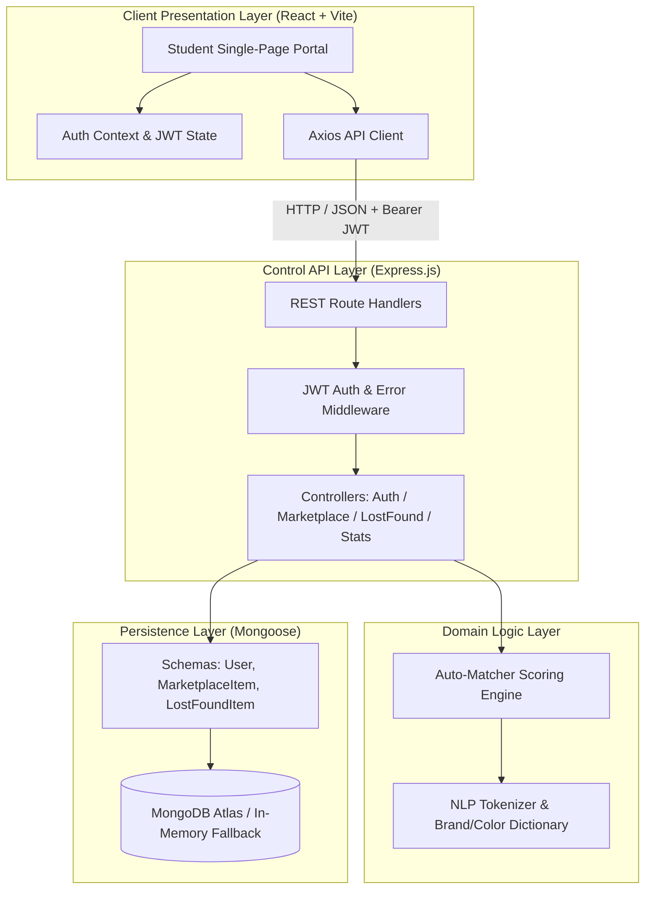
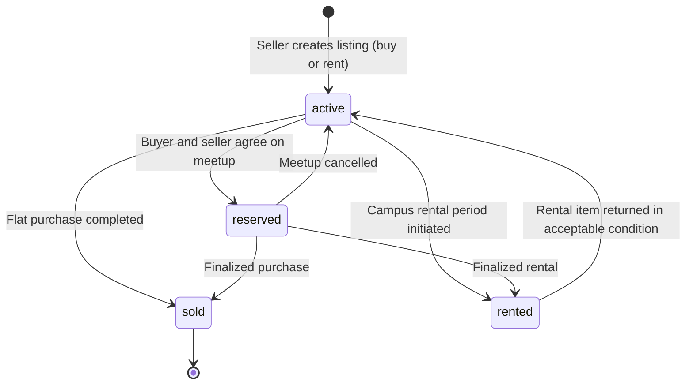
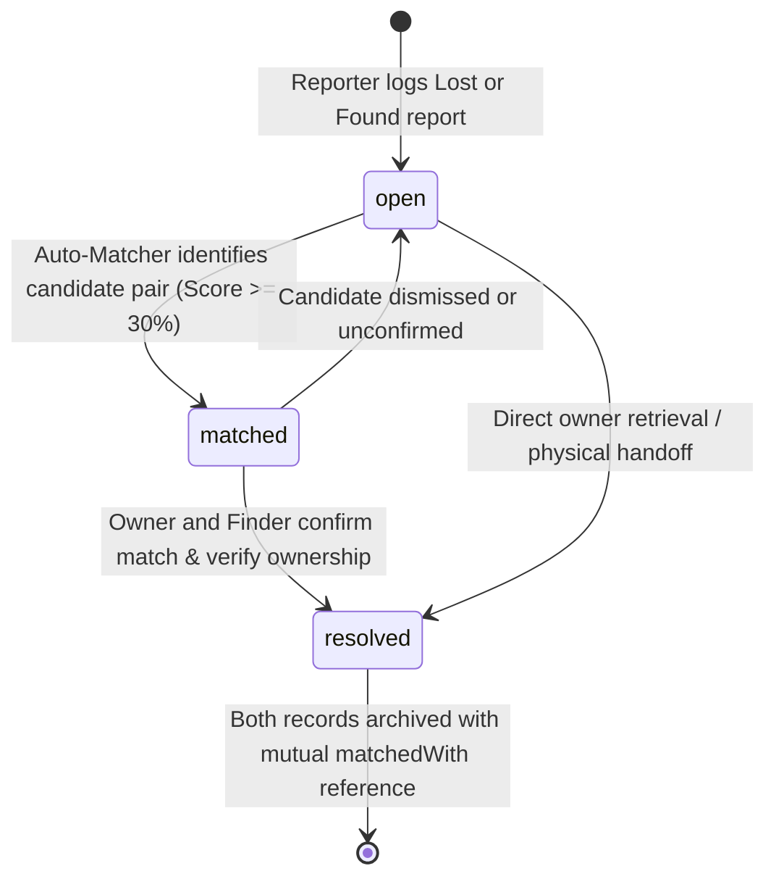

# CampusCircle 🎓🔄

> **The All-In-One College Campus Portal**: Peer-to-Peer Marketplace & Smart Lost-and-Found Auto-Matcher.
>
> 🌐 **Live Application**: [https://my-campus-lovat.vercel.app](https://my-campus-lovat.vercel.app)

CampusCircle combines two essential pillars of collegiate student life into a unified, domain-driven web application:
1. **Peer-to-Peer Campus Marketplace**: Rent or purchase textbooks, graphing calculators, lab gear, dorm equipment, and study tools directly from verified campus peers without commercial markups.
2. **Smart Lost-and-Found Auto-Matcher**: Automated heuristic scoring engine that analyzes category trees, building proximity, date recency, and NLP keyword stems to automatically link lost item reports with found item reports and provide explainable confidence scores.

---

## 📖 Domain Documentation

The repository strictly adheres to Domain-Driven Design (DDD) principles. The canonical source of truth for all domain concepts, entities, constraints, and vocabulary is defined in:

👉 **[`UBIQUITOUS_LANGUAGE.md`](./UBIQUITOUS_LANGUAGE.md)**

All team members, developers, documentation, and codebase symbols must use the standardized terms defined in that file.

---

## 🌟 Key Features

### 🛒 1. Peer-to-Peer Campus Marketplace
- **Flexible Listing Models**: Support for both **Flat Purchase (`buy`)** (one-off permanent transfer) and **Campus Rental (`rent`)** (temporary academic loan per day, week, month, or semester) with optional refundable security deposits.
- **Academic Categorization**: Books, Calculators & Tech, Lab & Stationery, Dorm & Room Gear, Electronics, and Sports & Fitness.
- **Campus-Specific Meetup Locations**: Tag and filter listings by safe on-campus physical landmarks (e.g., Student Union Quad, Science Library).
- **Direct Student Inquiries**: One-click modal for contact exchange (Campus Meetup, WhatsApp, Email, Phone) with safety guidance.
- **Lifecycle Management**: Clean status transitions across `active`, `reserved`, `rented`, and `sold`.

### 🔍 2. Smart Lost & Found Auto-Matcher
- **Dual Reporting Flow**: Intuitive reporting for both **Lost Item Reports** and **Found Item Reports**.
- **Auto-Matcher Scoring Engine (0 – 100%)**:
  - **Category Weight (35%)**: Exact category alignment (35 pts) or related category hierarchy (20–22 pts, e.g., Calculators ↔ Electronics).
  - **Textual & NLP Overlap (35%)**: Normalized tokenization, keyword stem overlap, plus specialized bonuses for **Brand Tokens** (+6 pts, e.g., TI-84, Hydro Flask, AirPods) and **Color Tokens** (+4 pts, e.g., Navy, Blue, Silver).
  - **Location Proximity (20%)**: Token overlap across incident locations (e.g., Main Library 2nd Floor vs. Library Printer Station).
  - **Temporal Closeness (10%)**: Dynamic weighting based on the calendar proximity of `dateOccurred` (≤ 3 days = 10 pts, ≤ 7 days = 7 pts, ≤ 14 days = 4 pts).
- **Explainable Match Reasons**: Generates transparent, human-readable justification lines alongside scores (e.g., `✓ Identical Category (Calculators)`, `✓ Location proximity: library`, `✓ Shared brand/model: ti-84`).
- **1-Click Match Confirmation & Resolution**: Direct two-way status updating to `resolved`, setting reciprocal `matchedWith` foreign references.

### 🔐 3. Authentication & Architecture
- **JWT Authentication**: Token-based authentication with bcrypt password hashing.
- **Verified Student Profiles**: Profiles capturing full name, university campus, student ID, and avatars.
- **1-Click Demo Accounts**: Instant test login buttons for Alex Rivera, Maya Chen, and Jordan Taylor.
- **Separation of Concerns**: Clean separation between Presentation, Controllers, Domain Services, and Data Access.
- **Zero-Config Database**: Connects to external MongoDB Atlas or local daemon, with an automatic embedded **In-Memory Fallback** (`mongodb-memory-server`) for frictionless local evaluation.

---

## 🏛️ Domain Architecture & Tech Stack



### Directory Structure

```
my_campus/
├── UBIQUITOUS_LANGUAGE.md    # Canonical domain vocabulary & invariant rules
├── README.md                 # System overview and architectural reference
├── package.json              # Root orchestration runner
├── server/                   # Express.js Backend API
│   ├── src/
│   │   ├── config/db.js      # MongoDB connection with In-Memory fallback
│   │   ├── models/           # Mongoose domain models (User, MarketplaceItem, LostFoundItem)
│   │   ├── services/         # Domain services (matcherService.js)
│   │   ├── controllers/      # Route controllers (auth, marketplace, lostFound, stats)
│   │   ├── middleware/       # JWT verification & centralized error handler
│   │   ├── routes/           # REST endpoint definitions
│   │   ├── seed/             # Campus demo seed data with pre-matched pairs
│   │   ├── app.js            # Express app assembly & middleware pipeline
│   │   └── server.js         # Server entry point & graceful shutdown
│   └── package.json
└── client/                   # React + Vite Frontend Client
    ├── src/
    │   ├── context/          # AuthContext (JWT session state & demo login)
    │   ├── services/api.js   # Centralized API client
    │   ├── components/       # UI components (Navbar, ItemCard, LostFoundCard, Modals)
    │   ├── pages/            # Views (Home, Marketplace, Lost & Found, Dashboard, Login)
    │   └── App.jsx           # Client router & page layout
    ├── vite.config.js        # Vite build config + API reverse proxy
    └── package.json
```

---

## 🔄 Domain Entity Lifecycles

### 1. Marketplace Listing Lifecycle



### 2. Lost & Found Incident Report Lifecycle



---

## 📡 REST API Reference

All API routes are prefixed under `/api`. Protected routes require the `Authorization: Bearer <token>` header.

### Authentication (`/api/auth`)
| Method | Endpoint | Access | Domain Description |
| --- | --- | --- | --- |
| `POST` | `/api/auth/register` | Public | Register a new student with email, password, campus, and student ID |
| `POST` | `/api/auth/login` | Public | Authenticate a student and receive a signed JWT |
| `GET` | `/api/auth/me` | Authenticated | Retrieve current authenticated student profile |

### Campus Marketplace (`/api/marketplace`)
| Method | Endpoint | Access | Domain Description |
| --- | --- | --- | --- |
| `GET` | `/api/marketplace` | Public | Filter listings by search query, category, listing type (`buy`/`rent`), condition, and price range |
| `GET` | `/api/marketplace/:id` | Public | Retrieve single listing details and increment view count |
| `POST` | `/api/marketplace` | Authenticated | Publish a new marketplace listing (owned by authenticated seller) |
| `PUT` | `/api/marketplace/:id` | Authenticated | Update an existing listing (restricted to seller or admin) |
| `DELETE` | `/api/marketplace/:id` | Authenticated | Remove an existing listing (restricted to seller or admin) |
| `GET` | `/api/marketplace/my/listings` | Authenticated | Fetch all listings authored by the current student |

### Lost & Found (`/api/lost-found`)
| Method | Endpoint | Access | Domain Description |
| --- | --- | --- | --- |
| `GET` | `/api/lost-found` | Public | List incident reports filtered by type (`lost`/`found`), category, status, and search query |
| `GET` | `/api/lost-found/:id` | Public | Retrieve details of an incident report including matched counterpart references |
| `POST` | `/api/lost-found` | Authenticated | Submit a new lost or found report; triggers immediate auto-matching check |
| `GET` | `/api/lost-found/:id/matches` | Public | Run heuristic auto-matcher against all active counterpart reports |
| `PUT` | `/api/lost-found/:id/resolve` | Authenticated | Confirm match, update status to `resolved`, and link both reports |
| `GET` | `/api/lost-found/my/reports` | Authenticated | Retrieve all lost and found reports submitted by the current student |

### Platform Metrics (`/api/stats`)
| Method | Endpoint | Access | Domain Description |
| --- | --- | --- | --- |
| `GET` | `/api/stats` | Public | Aggregate counts of active listings, resolved reports, and campus metrics |
| `GET` | `/api/health` | Public | Liveness probe returning service status and timestamp |

---

## 🧮 Auto-Matcher Scoring Formula

When evaluating a target report $T$ against a candidate counterpart report $C$ (where $T.type \neq C.type$ and $C.status \in \{\text{open}, \text{matched}\}$):

$$\text{Match Score} = \min\Big(100, \text{Category} + \text{TextualNLP} + \text{Location} + \text{Temporal}\Big)$$

| Dimension | Max Points | Evaluation Heuristic |
| --- | :---: | --- |
| **Category Weight** | 35 | • Exact match: **35 pts**<br>• Related hierarchy (Calculators ↔ Electronics): **22 pts**<br>• Related hierarchy (Bags ↔ Clothing): **20 pts** |
| **Textual & NLP Overlap** | 35 | • Base intersection: $\min(25, |\text{Tokens}_T \cap \text{Tokens}_C| \times 6)$<br>• Brand Token bonus: **+6 pts** if brand terms intersect (`ti-84`, `hydro`, `airpods`)<br>• Color Token bonus: **+4 pts** if color terms intersect (`navy`, `black`, `blue`) |
| **Location Proximity** | 20 | • Zone intersection: $\min(20, |\text{LocTokens}_T \cap \text{LocTokens}_C| \times 10)$ |
| **Temporal Closeness** | 10 | • $|Date_T - Date_C| \le 3\text{ days}$: **10 pts**<br>• $\le 7\text{ days}$: **7 pts**<br>• $\le 14\text{ days}$: **4 pts** |

### Confidence Bands
- **High Confidence**: Score $\ge 70\%$
- **Medium Confidence**: $45\% \le \text{Score} < 70\%$
- **Low Confidence**: Score $< 45\%$ (Excluded from top match previews)

---

## 🚀 Quick Start Guide

### Prerequisites
- **Node.js** (v18.0.0 or higher)
- **npm** (v9.0.0 or higher)

### 1. Install Dependencies
Run the command below in the project root to install dependencies across root, backend, and frontend:
```bash
npm run install:all
```

### 2. Configure Environment (Optional)
The backend runs out-of-the-box using the embedded **In-Memory Fallback** database. If you wish to connect to an external MongoDB Atlas cluster, create `server/.env`:
```env
PORT=5001
MONGODB_URI=mongodb+srv://<username>:<password>@cluster0.example.mongodb.net/campuscircle?retryWrites=true&w=majority
JWT_SECRET=campuscircle_super_secret_jwt_key_2026_dev
NODE_ENV=development
```

### 3. Start Both Backend & Frontend
```bash
npm run dev
```

- **Live Production App**: [https://my-campus-lovat.vercel.app](https://my-campus-lovat.vercel.app)
- **Frontend Client Portal**: [http://localhost:5173](http://localhost:5173)
- **Backend Control API**: [http://localhost:5001](http://localhost:5001)
- **API Health Check**: [http://localhost:5001/api/health](http://localhost:5001/api/health)

---

## 🧪 Pre-Seeded Demo Data & High-Confidence Match Pairs

On first launch, the system automatically initializes sample campus data containing pre-configured matching pairs:

1. **TI-84 Graphing Calculator (Library)**:
   - **Lost Item Report**: *Texas Instruments TI-84 Plus CE Calculator* (Library 2nd Floor, blue NASA sticker)
   - **Found Item Report**: *Found Black TI-84 Graphing Calculator with Blue Sticker* (Library 2nd Floor Printer)
   - 👉 **Auto-Match Result**: **100% High Match** *(Identical Category + Brand Token + Blue Sticker + Location overlap + 1-day delta)*
2. **Hydro Flask Water Bottle (Science Complex)**:
   - **Lost Item Report**: *Navy Blue 32oz Hydro Flask with Outdoor Stickers* (Science Building Room 204)
   - **Found Item Report**: *Found Navy Blue Hydro Flask Water Bottle* (Science Building Hallway)
   - 👉 **Auto-Match Result**: **85% High Match** *(Identical Category + Brand Token + Navy Color + Location overlap)*
3. **Apple AirPods Pro (Student Union)**:
   - **Lost Item Report**: *Apple AirPods Pro (2nd Gen)* (Student Union Cafeteria)
   - **Found Item Report**: *Found Apple Earbuds Case in Student Union* (Student Union Dining)
   - 👉 **Auto-Match Result**: **80% High Match** *(Related Category + Brand Token + Student Union Location)*

### Verified Demo Student Accounts (Password: `password123`):
| Name | Institutional Email | Campus | Student ID |
| --- | --- | --- | --- |
| **Alex Rivera** | `alex@campus.edu` | Northwood University | NW-2024-819 |
| **Maya Chen** | `maya@campus.edu` | Northwood University | NW-2025-104 |
| **Jordan Taylor** | `jordan@campus.edu` | Northwood University | NW-2023-442 |

*(Tip: You can also click the "1-Click Demo Student" button on the navigation bar or login page for instant authentication!)*
